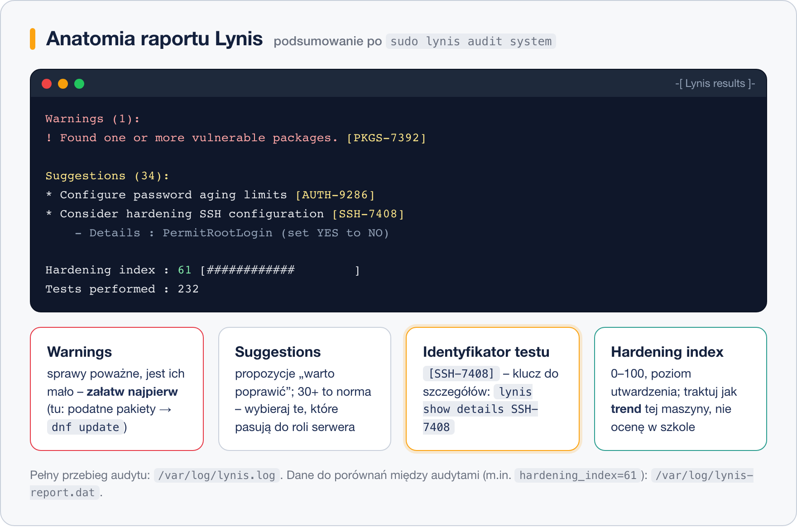

# Audyt bezpieczeństwa z Lynis

> **W tej lekcji:** zainstalujesz narzędzie audytowe Lynis (z EPEL albo prosto z GitHuba),
> uruchomisz pierwszy skan i nauczysz się czytać jego wynik: ostrzeżenia, sugestie i hardening index.

## Po co mi to?

Skąd wiesz, czy Twój serwer jest „bezpieczny”? Lista rzeczy do sprawdzenia jest długa: hasła,
SSH, uprawnienia plików, zbędne usługi, aktualizacje… Łatwo coś przeoczyć, zwłaszcza na początku.

**Audyt bezpieczeństwa** to systematyczne porównanie konfiguracji systemu z listą dobrych praktyk.
**Lynis** robi to automatycznie: w kilka minut przegląda setki ustawień i wypisuje, co odbiega od
zaleceń. To jak przegląd techniczny samochodu – nie naprawia, ale mówi, co wymaga uwagi. Lynis jest
darmowy, open-source (rozwijany przez firmę CISOfy) i działa lokalnie: niczego nie wysyła w sieć,
niczego też **sam nie zmienia** w systemie.

## Jak to działa

Lynis uruchamia po kolei grupy testów (system plików, uwierzytelnianie, SSH, jądro, sieć…).
Każdy test kończy się wynikiem, a na końcu dostajesz podsumowanie z trzema rodzajami informacji:

- **Warnings (ostrzeżenia)** – sprawy poważne, do załatwienia w pierwszej kolejności.
- **Suggestions (sugestie)** – zalecenia „warto poprawić”; będzie ich dużo, to normalne.
- **Hardening index** – liczba 0–100 opisująca ogólny poziom utwardzenia (ang. hardening –
  utwardzanie, czyli zaostrzanie konfiguracji). Świeży system ma zwykle kilkadziesiąt punktów.



Każde ostrzeżenie i sugestia ma **identyfikator testu**, np. `SSH-7408` czy `AUTH-9286`. To klucz,
po którym sprawdzisz szczegóły – lokalnie (`lynis show details SSH-7408`) albo w internetowym
katalogu testów CISOfy.

Wyniki lądują też w plikach:

| Plik | Co zawiera |
|---|---|
| `/var/log/lynis.log` | szczegółowy przebieg audytu, test po teście |
| `/var/log/lynis-report.dat` | dane w formie `klucz=wartość` – m.in. `hardening_index=…`; łatwe do porównywania między audytami |

## W praktyce

### Instalacja – droga 1: pakiet z EPEL

Najprościej przez repozytorium EPEL:

```bash
# włączamy EPEL i instalujemy pakiet
sudo dnf install epel-release
sudo dnf install lynis
```

> **Uwaga:** pakiet w EPEL bywa starszy niż bieżące wydanie Lynisa. Do nauki i okresowych
> przeglądów w zupełności wystarczy. Producent (CISOfy) udostępnia też własne repozytorium RPM
> z nowszymi wydaniami – opis znajdziesz na packages.cisofy.com.

### Instalacja – droga 2: prosto z GitHuba

Lynis to zestaw skryptów powłoki – nie wymaga kompilacji, więc można go po prostu pobrać:

```bash
# klonujemy oficjalne repozytorium do /usr/local
sudo dnf install git
sudo git clone https://github.com/CISOfy/lynis /usr/local/lynis
```

```bash
# uruchamiamy z katalogu z kodem (./lynis, nie samo lynis)
cd /usr/local/lynis
sudo ./lynis audit system
```

Ta droga daje zawsze najnowszą wersję i działa nawet bez dodatkowych repozytoriów;
aktualizacja to `sudo git -C /usr/local/lynis pull`.

### Pierwszy audyt

```bash
# sprawdzamy, że narzędzie działa
lynis show version
```

```bash
# pełny audyt systemu – musi iść przez sudo, inaczej część testów zostanie pominięta
sudo lynis audit system
```

Audyt trwa kilka minut i zatrzymuje się po każdej grupie testów (Enter kontynuuje).
Bez pauz: `sudo lynis audit system --quick`.

> Przy pierwszym uruchomieniu może pojawić się komunikat
> `Translation file (db/languages/pl) needs an update [OUTDATED]` – to informacja
> o nieaktualnym polskim tłumaczeniu, nie błąd. Audyt idzie dalej.

Fragment podsumowania wygląda tak:

```text
  -[ Lynis results ]-

  Warnings (1):
  ----------------------------
  ! Found one or more vulnerable packages. [PKGS-7392]
      https://cisofy.com/lynis/controls/PKGS-7392/

  Suggestions (34):
  ----------------------------
  * Configure password aging limits [AUTH-9286]
  * Consider hardening SSH configuration [SSH-7408]
      - Details  : PermitRootLogin (set YES to NO)
  ...

  Lynis security scan details:
  Hardening index : 61 [############        ]
  Tests performed : 232
```

### Czytanie wyniku

1. **Najpierw warnings.** Jest ich mało i są konkretne (np. podatne pakiety → `sudo dnf update`).
2. **Potem suggestions**, ale z głową – to propozycje, nie rozkazy. Szczegóły testu:

```bash
# co dokładnie Lynis sprawdził i co proponuje
sudo lynis show details SSH-7408
```

3. **Hardening index traktuj jak trend**, nie jak ocenę w szkole. Ważne, by po Twoich zmianach
   rósł – porównuj między audytami:

```bash
# wynik liczbowy z pliku raportu
sudo grep hardening_index /var/log/lynis-report.dat
```

```text
hardening_index=61
```

## Najczęstsze błędy i pułapki

- **Uruchamianie bez `sudo`.** Lynis zadziała, ale pominie testy wymagające roota i wynik będzie
  niemiarodajny. Audyt systemu zawsze przez `sudo`.
- **Panika na widok 30+ sugestii.** To normalne nawet na zadbanym serwerze. Sugestie są pisane
  „na wszelki wypadek” – część nie dotyczy Twojej roli serwera.
- **Traktowanie hardening index jak celu samego w sobie.** Da się „wykręcić wynik” zmianami, które
  nic nie dają, a przeszkadzają. Index to termometr, nie lekarstwo.
- **Wdrażanie wszystkich zaleceń na ślepo** – o tym cała następna lekcja. Jedno nieprzemyślane
  ustawienie SSH potrafi odciąć Cię od serwera.
- **Porównywanie indexu między różnymi maszynami.** Inna rola serwera = inne testy; porównuj
  tylko tę samą maszynę w czasie.

## Podsumowanie

- Lynis to darmowy audytor bezpieczeństwa: sprawdza setki ustawień, niczego nie zmienia.
- Instalacja: `dnf install lynis` (po włączeniu EPEL) albo `git clone` repozytorium CISOfy.
- Audyt: `sudo lynis audit system`; wyniki w terminalu oraz w `/var/log/lynis.log`
  i `/var/log/lynis-report.dat`.
- Kolejność czytania: warnings → suggestions → hardening index (jako trend).
- Identyfikator testu (`SSH-7408`) prowadzi do szczegółów: `lynis show details`.

| Zadanie | Polecenie |
|---|---|
| audyt systemu | `sudo lynis audit system` |
| audyt bez pauz | `sudo lynis audit system --quick` |
| szczegóły testu | `sudo lynis show details SSH-7408` |
| wersja | `lynis show version` |
| wynik liczbowy | `sudo grep hardening_index /var/log/lynis-report.dat` |
| lista grup testów | `lynis show groups` |

## Zobacz też

- [Utwardzanie systemu krok po kroku](2.%20Utwardzanie%20systemu%20krok%20po%20kroku.md) – jak rozsądnie wdrożyć zalecenia.
- [Moduł 16. SELinux](../16.%20SELinux/0.%20O%20module.md) – mechanizm, który Lynis sprawdza jednym z pierwszych testów.
- [Moduł 18. Logi systemowe](../18.%20Logi%20systemowe/0.%20O%20module.md) – gdzie system zapisuje zdarzenia, o które dba część zaleceń.
