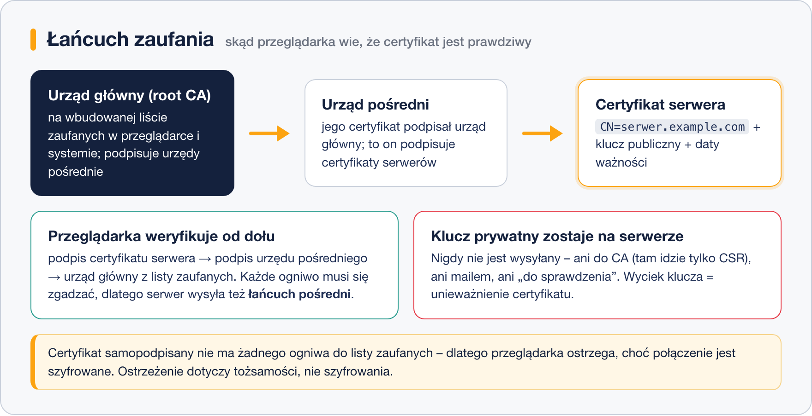

# HTTPS i certyfikaty – podstawy

> **W tej lekcji:** zrozumiesz, co dokładnie daje HTTPS, czym jest certyfikat, urząd certyfikacji
> i łańcuch zaufania, oraz czym różni się certyfikat samopodpisany od kupionego i od Let's Encrypt.

## Po co mi to?

Przeglądarka przy „zwykłym” HTTP przesyła wszystko jawnym tekstem – hasła, formularze, ciasteczka.
Każdy po drodze (Wi-Fi w kawiarni, operator, administrator sieci) może to czytać i podmieniać.
Dlatego standardem jest **HTTPS**: to samo HTTP, ale w szyfrowanym tunelu **TLS** (Transport Layer
Security; starsza nazwa SSL przylgnęła tak mocno, że używa się jej do dziś – stąd „certyfikat SSL”).

Administrator serwera WWW musi umieć ten tunel skonfigurować: wygenerować lub wgrać certyfikat,
wskazać go serwerowi i pilnować daty ważności. Wygasły certyfikat to jedna z najczęstszych,
najbardziej widowiskowych awarii – strona „pada” dla wszystkich naraz, choć serwer działa.

## Jak to działa

HTTPS załatwia trzy rzeczy:

1. **Poufność** – treść jest zaszyfrowana; podsłuchujący widzi tylko, z jakim serwerem rozmawiasz.
2. **Integralność** – nikt po drodze nie podmieni treści (np. nie wstrzyknie reklam).
3. **Tożsamość** – masz dowód, że rozmawiasz z prawdziwym `bank.pl`, a nie podstawioną kopią.

Pierwsze dwie daje kryptografia. Trzecią – **certyfikat**.

### Certyfikat i klucze

Serwer ma parę kluczy: **prywatny** i **publiczny**. To, co zaszyfrowano kluczem publicznym,
odszyfruje tylko klucz prywatny – dzięki temu przeglądarka może bezpiecznie uzgodnić z serwerem
szyfrowanie, nie znając żadnego sekretu z góry.

**Certyfikat** to klucz publiczny serwera + informacje o nim (przede wszystkim nazwa domeny
i okres ważności), **podpisane cyfrowo** przez kogoś zaufanego. Podpis gwarantuje: „potwierdzam,
że ten klucz należy do tej domeny”.

> **Klucz prywatny NIGDY nie opuszcza serwera.** Nie wysyłasz go mailem, nie wrzucasz do
> repozytorium, nie udostępniasz „do sprawdzenia”. Kto ma klucz prywatny, ten może podszywać się
> pod Twój serwer i odszyfrowywać ruch. Wyciek = natychmiastowe unieważnienie certyfikatu.

### Urząd certyfikacji i łańcuch zaufania

Tym „kimś zaufanym” jest **urząd certyfikacji** (ang. Certificate Authority, CA) – firma lub
organizacja, która przed podpisaniem sprawdza, czy naprawdę kontrolujesz domenę. Przeglądarki
i systemy mają wbudowaną listę głównych urzędów (ang. root CA), którym ufają z góry.

W praktyce Twój certyfikat rzadko podpisuje bezpośrednio urząd główny – robi to **urząd pośredni**
(ang. intermediate CA), którego certyfikat podpisał urząd główny. Powstaje **łańcuch zaufania**:

Przeglądarka dostaje od serwera jego certyfikat plus certyfikaty pośrednie i sprawdza podpisy
ogniwo po ogniwie, aż dojdzie do urzędu głównego ze swojej listy. Dlatego przy instalacji
certyfikatu od CA wgrywa się też „łańcuch” – bez niego część klientów nie zbuduje ścieżki
do korzenia i zgłosi błąd.

### Skąd wziąć certyfikat

| Rodzaj | Kto podpisuje | Koszt | Kiedy używać |
|---|---|---|---|
| **samopodpisany** (self-signed) | Ty sam, własnym kluczem | darmowy | testy, sieci wewnętrzne, laboratorium – przeglądarka ostrzega, bo nikt zaufany nie potwierdził tożsamości |
| **Let's Encrypt** | zaufany, darmowy CA | darmowy | publiczne strony z własną domeną; ważność 90 dni, odnawianie automatyczne |
| **komercyjny DV** (Domain Validation) | komercyjny CA, sprawdza tylko kontrolę nad domeną | płatny | jak Let's Encrypt, gdy firma wymaga wsparcia/faktury |
| **komercyjny OV/EV** (Organization/Extended Validation) | komercyjny CA, weryfikuje też organizację | droższy | banki, instytucje – w certyfikacie są dane firmy |

Technicznie wszystkie szyfrują tak samo dobrze. Różnica to **kto i jak mocno potwierdził
tożsamość** – i czy przeglądarka zaufa bez ostrzeżeń.

### Pliki, które spotkasz

| Plik | Co to | Typowe rozszerzenia |
|---|---|---|
| klucz prywatny | sekret serwera | `.key` |
| certyfikat | klucz publiczny + dane, podpisane przez CA | `.crt`, `.pem` |
| łańcuch pośredni | certyfikaty urzędów pośrednich | `.pem`, `-chain.crt`, `ca-bundle.crt` |
| CSR | żądanie podpisania – wysyłasz do CA, powstaje z klucza prywatnego | `.csr` |

## Najczęstsze błędy i pułapki

- **Wysłanie klucza prywatnego do CA albo wsparcia.** CA potrzebuje tylko CSR; nikt nigdy nie ma
  prawa prosić o `.key`.
- **Mylenie szyfrowania z zaufaniem.** Strona z certyfikatem samopodpisanym też szyfruje – ale nie
  wiadomo, z kim rozmawiasz. Ostrzeżenie przeglądarki dotyczy tożsamości, nie szyfrowania.
- **Ignorowanie daty ważności.** Certyfikaty wygasają (Let's Encrypt już po 90 dniach). Brak
  automatu lub przypomnienia = awaria z zaskoczenia.
- **Przekonanie, że kłódka = bezpieczna strona.** Kłódka mówi tylko, że połączenie jest szyfrowane
  i domena potwierdzona. Oszust też może mieć certyfikat dla swojej domeny.

## Podsumowanie

- HTTPS = HTTP w tunelu TLS: poufność, integralność i potwierdzenie tożsamości serwera.
- Certyfikat to podpisany przez CA klucz publiczny z nazwą domeny i datą ważności.
- Zaufanie buduje łańcuch: certyfikat serwera → urząd pośredni → urząd główny z listy przeglądarki.
- Klucz prywatny nigdy nie opuszcza serwera.
- Self-signed do testów, Let's Encrypt do publicznych stron, OV/EV tam, gdzie liczy się
  zweryfikowana organizacja.

## Zobacz też

- [Apache z HTTPS – certyfikat self-signed](2.%20Apache%20z%20HTTPS%20–%20certyfikat%20self-signed.md) – teoria w praktyce na własnym serwerze.
- [Podmiana certyfikatu i Let's Encrypt](3.%20Podmiana%20certyfikatu%20i%20Let's%20Encrypt.md) – certyfikaty od prawdziwych CA.
- [Moduł 8. Zdalna administracja](../../Dział%202%20-%20Podstawy%20pracy%20z%20systemem%20Linux/08.%20Zdalna%20administracja/0.%20O%20module.md) – klucze SSH, ta sama idea pary kluczy.
