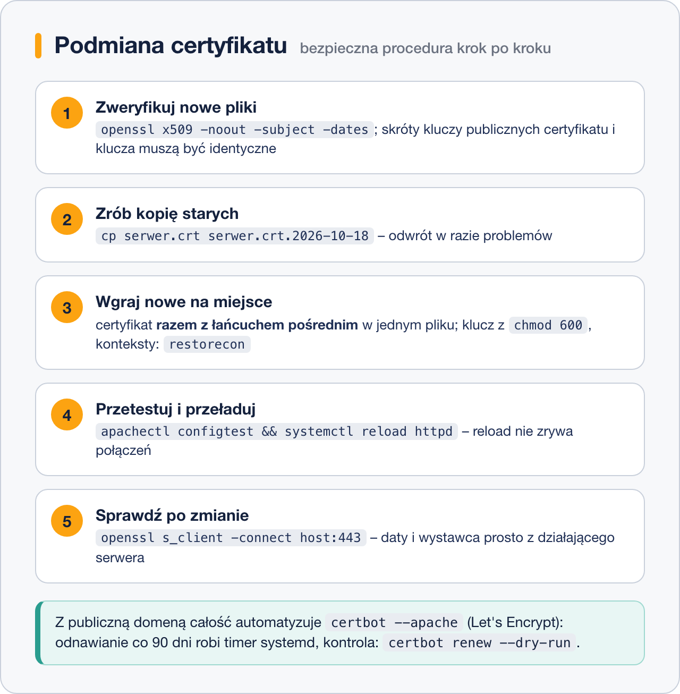

# Podmiana certyfikatu i Let's Encrypt

> **W tej lekcji:** nauczysz się bezpiecznie podmieniać certyfikat w działającym Apache'u –
> z weryfikacją plików przed i po – oraz zautomatyzujesz całość darmowym Let's Encrypt i certbotem.

## Po co mi to?

Certyfikaty wygasają. Komercyjne zwykle po roku, Let's Encrypt po 90 dniach. Podmiana certyfikatu
to więc rutyna administratora serwera WWW – i jednocześnie operacja, przy której łatwo o wpadkę:
pomylone pliki, brak łańcucha, restart z błędną konfiguracją. Ta lekcja daje bezpieczną procedurę
oraz drogę na skróty: automat, który odnawia certyfikat za Ciebie.

## Jak to działa

Od urzędu certyfikacji dostajesz zwykle trzy pliki: **certyfikat** domeny, **łańcuch** urzędów
pośrednich i masz już u siebie **klucz prywatny** (powstał razem z CSR – żądaniem podpisania).
Podmiana to: wgranie plików na miejsce starych, test konfiguracji i przeładowanie Apache'a.
Każdy krok da się zweryfikować poleceniem `openssl` – i warto, bo błędy wychodzą dopiero
u klientów.



W nowszych wersjach `mod_ssl` (Apache 2.4.8+, czyli RHEL 9/10) łańcuch pośredni dokleja się
do pliku certyfikatu (`SSLCertificateFile` z pełnym łańcuchem) – osobna dyrektywa
`SSLCertificateChainFile` jest przestarzała, choć nadal działa.

## W praktyce

### Krok 1: weryfikacja nowych plików, zanim cokolwiek ruszysz

```bash
# kto wystawił, dla kogo i do kiedy ważny
openssl x509 -in nowy.crt -noout -subject -issuer -dates
```

```text
subject=CN = serwer.example.com
issuer=C = US, O = Let's Encrypt, CN = R13
notBefore=Oct 18 00:00:00 2026 GMT
notAfter=Jan 16 23:59:59 2027 GMT
```

```bash
# czy klucz pasuje do certyfikatu – odciski kluczy publicznych muszą być IDENTYCZNE
openssl x509 -in nowy.crt -noout -pubkey | openssl sha256
openssl pkey -in nowy.key -pubout | openssl sha256
```

Jeśli skróty się różnią – to nie jest para; dalej nie idziesz.

### Krok 2: kopia zapasowa i wgranie

```bash
# stare pliki na bok (z datą), nowe na miejsce
sudo cp /etc/pki/tls/certs/serwer.crt /etc/pki/tls/certs/serwer.crt.2026-10-18
sudo cp /etc/pki/tls/private/serwer.key /etc/pki/tls/private/serwer.key.2026-10-18
# certyfikat + łańcuch w jednym pliku (kolejność: najpierw certyfikat domeny, potem pośrednie)
cat nowy.crt lancuch.pem | sudo tee /etc/pki/tls/certs/serwer.crt > /dev/null
sudo cp nowy.key /etc/pki/tls/private/serwer.key
sudo chmod 600 /etc/pki/tls/private/serwer.key
sudo restorecon -v /etc/pki/tls/certs/serwer.crt /etc/pki/tls/private/serwer.key
```

### Krok 3: test i przeładowanie

```bash
# składnia OK → reload (łagodniejszy niż restart: nie zrywa trwających połączeń)
sudo apachectl configtest && sudo systemctl reload httpd
```

### Krok 4: kontrola po zmianie

```bash
# co naprawdę serwuje serwer: daty ważności i wystawca prosto z połączenia TLS
echo | openssl s_client -connect localhost:443 -servername serwer.example.com 2>/dev/null \
  | openssl x509 -noout -dates -issuer
```

Jeśli daty to wciąż stare wartości – Apache nie przeładował konfiguracji albo wgrałeś pliki
w inne miejsce, niż wskazuje `ssl.conf`.

### Let's Encrypt: certyfikat i odnawianie automatem

Dla serwera z **publiczną domeną** (CA musi móc połączyć się z nią po HTTP, by sprawdzić,
że kontrolujesz adres) całą powyższą procedurę zastępuje **certbot**:

```bash
# certbot z wtyczką apache jest w EPEL
sudo dnf install epel-release
sudo dnf install certbot python3-certbot-apache
```

```bash
# wystawienie certyfikatu i automatyczna konfiguracja Apache'a
sudo certbot --apache -d serwer.example.com
```

Certbot: potwierdzi kontrolę nad domeną, pobierze certyfikat, sam wpisze ścieżki do konfiguracji
Apache'a i zaproponuje przekierowanie HTTP→HTTPS. Pliki trafiają do
`/etc/letsencrypt/live/serwer.example.com/` (`fullchain.pem` = certyfikat + łańcuch,
`privkey.pem` = klucz).

Certyfikaty Let's Encrypt żyją 90 dni, ale pakiet instaluje **timer systemd**, który odnawia je
automatycznie:

```bash
# czy automat działa i próba generalna odnowienia (bez faktycznej zmiany)
systemctl list-timers | grep certbot
sudo certbot renew --dry-run
```

```bash
# przegląd posiadanych certyfikatów i ich dat
sudo certbot certificates
```

> **W laboratorium szkoleniowym** (bez publicznej domeny) certbot nie przejdzie weryfikacji –
> dlatego ćwiczenia robimy na certyfikacie samopodpisanym. Procedura podmiany jest identyczna.

## Najczęstsze błędy i pułapki

- **Brak łańcucha pośredniego.** Na Twoim komputerze działa (przeglądarka dociąga brakujące
  certyfikaty), u części klientów i w `curl` – błąd `unable to get local issuer certificate`.
  Zawsze serwuj pełny łańcuch.
- **`reload` bez `configtest`** – przy błędzie składni usługa może stanąć. Zawsze parą:
  `apachectl configtest && systemctl reload httpd`.
- **Podmiana certyfikatu bez klucza** (albo odwrotnie), gdy CA wystawił nowy klucz. Stąd test
  zgodności skrótów z kroku 1 – rób go zawsze.
- **Wygasły certyfikat, bo „automat działał”.** Timer certbota mógł się wysypać (np. port 80
  zamknięty po zmianach w firewallu). Raz na jakiś czas `certbot renew --dry-run` i monitoring dat.
- **Kopiowanie plików z `/etc/letsencrypt/live/` zamiast wskazania ich w konfiguracji.** To
  dowiązania symboliczne podmieniane przy odnowieniu – kopiując, zamrażasz starą wersję.

## Podsumowanie

- Procedura podmiany: zweryfikuj pliki → kopia zapasowa → wgraj (certyfikat + łańcuch razem) →
  `configtest` → `reload` → sprawdź przez `openssl s_client`.
- Zgodność pary klucz–certyfikat sprawdzają identyczne skróty kluczy publicznych.
- `openssl x509 -noout -dates` czyta daty z pliku; `openssl s_client` – prosto z działającego serwera.
- Let's Encrypt + certbot automatyzują wszystko dla publicznych domen; odnawianiem zarządza
  timer systemd, kontrolujesz go przez `certbot renew --dry-run`.

| Zadanie | Polecenie |
|---|---|
| dane i daty certyfikatu | `openssl x509 -in plik.crt -noout -subject -issuer -dates` |
| czy klucz pasuje | porównaj `openssl x509 … -pubkey \| openssl sha256` i `openssl pkey … -pubout \| openssl sha256` |
| test + przeładowanie | `sudo apachectl configtest && sudo systemctl reload httpd` |
| co serwuje serwer | `echo \| openssl s_client -connect host:443 \| openssl x509 -noout -dates` |
| certyfikat Let's Encrypt | `sudo certbot --apache -d domena` |
| kontrola odnawiania | `sudo certbot renew --dry-run`, `sudo certbot certificates` |

## Zobacz też

- [Apache z HTTPS – certyfikat self-signed](2.%20Apache%20z%20HTTPS%20–%20certyfikat%20self-signed.md) – baza, na której tu pracujemy.
- [HTTPS i certyfikaty – podstawy](1.%20HTTPS%20i%20certyfikaty%20–%20podstawy.md) – czym jest łańcuch, który tu wgrywasz.
- [Moduł 15. Crontab](../15.%20Crontab/0.%20O%20module.md) – zadania cykliczne; odnawianie certbota to ich systemd-owy odpowiednik (timer).
