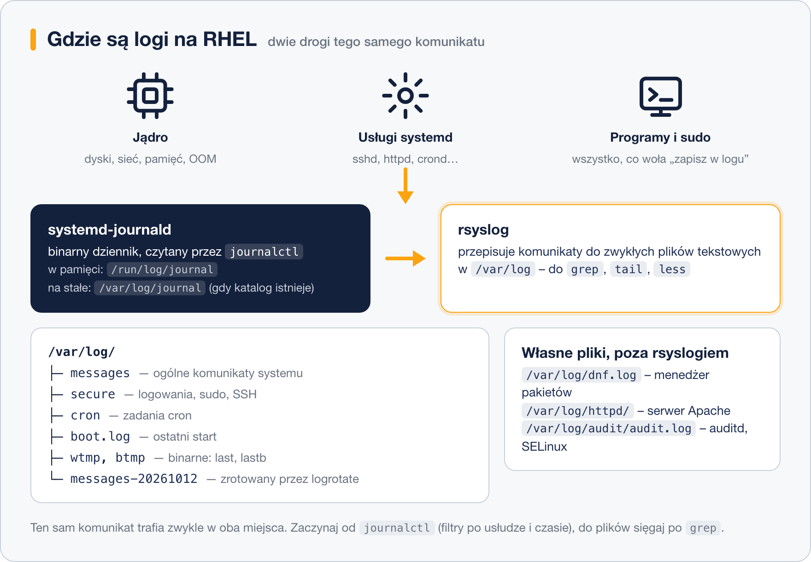

# Gdzie szukać logów

> **W tej lekcji:** dowiesz się, gdzie system RHEL zapisuje informacje o swojej pracy, i nauczysz się
> wyciągać z dziennika systemd dokładnie te wpisy, których potrzebujesz – z jednej usługi, z ostatniej
> godziny, tylko błędy.

Serwer rzadko mówi wprost, co mu dolega. Usługa nie wstaje, użytkownik „nie może się zalogować”,
w nocy coś się zrestartowało. Zamiast zgadywać, zaglądasz do **logów** (ang. log – dziennik):
plików i baz, w których system i programy zapisują, co robiły, co im się udało, a co nie.

Jeśli znasz Windows: to odpowiednik Podglądu zdarzeń (Event Viewer). Różnica jest taka, że na Linuksie
logi to zwykły tekst, który przeszukujesz z terminala – szybciej i bez klikania.

## Jak to działa

Na RHEL 9/10 logi trafiają do dwóch miejsc naraz:

1. **Dziennik systemd** (ang. journal) – binarna baza prowadzona przez demona `systemd-journald`.
   Zbiera komunikaty jądra, usług systemd, programów i procesu startu. Czytasz go poleceniem
   `journalctl`. To **główne narzędzie** na RHEL.
2. **rsyslog** – klasyczny demon logowania, który te same komunikaty zapisuje do zwykłych plików
   tekstowych w `/var/log`. Dzięki temu da się je czytać `cat`, `grep` i `tail`.

Do tego kilka programów prowadzi własne pliki poza oboma systemami: `dnf`, serwer WWW `httpd`
czy demon audytu `auditd`.



### Najważniejsze pliki w `/var/log`

| Plik | Co zawiera |
|---|---|
| `/var/log/messages` | ogólne komunikaty systemu i większości usług |
| `/var/log/secure` | logowania, `sudo`, SSH – wszystko związane z bezpieczeństwem |
| `/var/log/cron` | uruchomienia zadań cron |
| `/var/log/dnf.log` | historia instalacji i aktualizacji pakietów |
| `/var/log/boot.log` | komunikaty z ostatniego startu systemu |
| `/var/log/maillog` | poczta (jeśli serwer ją obsługuje) |
| `/var/log/httpd/` | katalog z logami serwera Apache |
| `/var/log/audit/audit.log` | dziennik audytu (`auditd`) – m.in. decyzje SELinuksa |
| `/var/log/wtmp`, `/var/log/btmp` | binarne rejestry logowań; czyta się je poleceniami `last` i `lastb` |

Pliki w `/var/log` należą do roota – do większości potrzebujesz `sudo`.

### Trwałość dziennika systemd

Domyślnie na RHEL dziennik systemd żyje w pamięci (`/run/log/journal`) i **znika po restarcie**.
Pliki rsyslog zostają, więc nic nie ginie bezpowrotnie, ale wygodniej mieć `journalctl` z historią.
Wystarczy utworzyć katalog `/var/log/journal` – journald zacznie w nim zapisywać na stałe.

### Rotacja logów

Logi rosną bez końca, więc program `logrotate` (uruchamiany raz dziennie przez `logrotate.timer`)
zmienia nazwy starych plików (`messages-20261012`), kompresuje je i po pewnym czasie usuwa.
Ustawienia są w `/etc/logrotate.conf` i katalogu `/etc/logrotate.d/`. Dziennik systemd ma własny
limit rozmiaru w `/etc/systemd/journald.conf`.

## W praktyce

```bash
# cały dziennik od najstarszego wpisu (wyjście strona po stronie, q kończy)
sudo journalctl
```

```bash
# tylko komunikaty jednej usługi – tu serwera SSH
sudo journalctl -u sshd
```

```text
paź 18 09:12:01 serwer sshd[1432]: Server listening on 0.0.0.0 port 22.
paź 18 09:40:17 serwer sshd[2210]: Accepted publickey for anna from 192.168.10.25 port 51822 ssh2
```

```bash
# wpisy z bieżącego uruchomienia systemu; -b -1 to poprzednie uruchomienie
sudo journalctl -b
sudo journalctl -b -1
```

```bash
# tylko błędy i gorsze (priorytet err, crit, alert, emerg)
sudo journalctl -p err
```

```bash
# wszystko z ostatniej godziny; działają też "today", "yesterday", "2026-10-18 08:00"
sudo journalctl --since "1 hour ago"
```

```bash
# śledzenie na żywo – nowe wpisy pojawiają się na bieżąco (Ctrl+C kończy)
sudo journalctl -f
```

```bash
# komunikaty jądra (sprzęt, sterowniki, dyski, sieć) – to samo pokazuje dmesg
sudo journalctl -k
```

Opcje da się łączyć. Pytanie „jakie błędy zgłosił Apache od rana?” to jedno polecenie:

```bash
sudo journalctl -u httpd -p err --since today
```

| Opcja | Znaczenie |
|---|---|
| `-u nazwa` | tylko jednostka (usługa) systemd |
| `-b`, `-b -1` | bieżące / poprzednie uruchomienie |
| `-p err` | priorytet od `err` w górę (skala: debug, info, notice, warning, err, crit, alert, emerg) |
| `--since`, `--until` | zakres czasu |
| `-f` | śledź na żywo |
| `-k` | tylko jądro |
| `-r` | od najnowszych |
| `-n 50` | ostatnie 50 wpisów |
| `-x` | dopisz wyjaśnienia do znanych komunikatów |

Pliki tekstowe czytasz zwykłymi narzędziami:

```bash
# ostatnie 20 linii ogólnego logu
sudo tail -n 20 /var/log/messages
```

```bash
# log na żywo – wygodne podczas testowania logowania przez SSH
sudo tail -f /var/log/secure
```

```bash
# kto i kiedy się logował (z /var/log/wtmp) oraz nieudane próby (z /var/log/btmp)
last -n 5
sudo lastb -n 5
```

```text
anna     pts/0        192.168.10.25    Sat Oct 18 09:40   still logged in
jan      pts/1        192.168.10.31    Fri Oct 17 16:02 - 17:15  (01:13)
reboot   system boot  5.14.0-503.el9   Fri Oct 17 08:00   still running
```

Włączenie trwałego dziennika:

```bash
# katalog na dysku + poprawne uprawnienia; od teraz journald pisze na stałe
sudo mkdir -p /var/log/journal
sudo systemd-tmpfiles --create --prefix /var/log/journal
sudo systemctl restart systemd-journald
```

```bash
# ile miejsca zajmuje dziennik i jak przyciąć go do 200 MB
sudo journalctl --disk-usage
sudo journalctl --vacuum-size=200M
```

## Najczęstsze błędy i pułapki

- **`journalctl` bez `sudo`** pokazuje tylko wpisy Twojego użytkownika. Brak komunikatów usługi
  nie znaczy, że ich nie ma – dodaj `sudo`.
- **Po restarcie dziennik jest pusty.** To normalne, gdy `/var/log/journal` nie istnieje. Historia
  czeka w `/var/log/messages`; na stałe włącz trwały dziennik jak wyżej.
- **Czas w logu nie zgadza się z zegarem.** `journalctl` pokazuje czas lokalny, a część programów
  (np. Apache, audyt) zapisuje czas UTC lub znacznik uniksowy. `journalctl --utc` ujednolica.
- **`grep` w `/var/log/messages` nie znajduje usługi**, bo szukasz po nazwie pakietu, a program loguje
  pod inną nazwą (np. `sshd`, nie `openssh`). Sprawdź `systemctl status nazwa` – pokazuje ostatnie wpisy.
- **Pełny `/var`** przez rozrośnięte logi. Zajrzyj do `du -sh /var/log/*` i sprawdź, czy `logrotate.timer`
  jest aktywny (`systemctl status logrotate.timer`).

## Podsumowanie

- Na RHEL logi są w dwóch miejscach: dziennik systemd (`journalctl`) i pliki tekstowe w `/var/log` (rsyslog).
- `journalctl` filtruje po usłudze (`-u`), czasie (`--since`), priorytecie (`-p`) i rozruchu (`-b`).
- `/var/log/secure` to pierwszy adres przy problemach z logowaniem, `/var/log/messages` – ogólny.
- Dziennik systemd nie przetrwa restartu, dopóki nie utworzysz `/var/log/journal`.
- O porządek dba `logrotate`; na pełny dysk patrz najpierw w `/var/log`.

| Zadanie | Polecenie |
|---|---|
| błędy jednej usługi od dziś | `sudo journalctl -u httpd -p err --since today` |
| co działo się przed restartem | `sudo journalctl -b -1 -p warning` |
| podgląd na żywo | `sudo journalctl -f` lub `sudo tail -f /var/log/secure` |
| komunikaty jądra | `sudo journalctl -k` |
| ostatnie logowania | `last`, `sudo lastb` |
| rozmiar dziennika | `sudo journalctl --disk-usage` |
