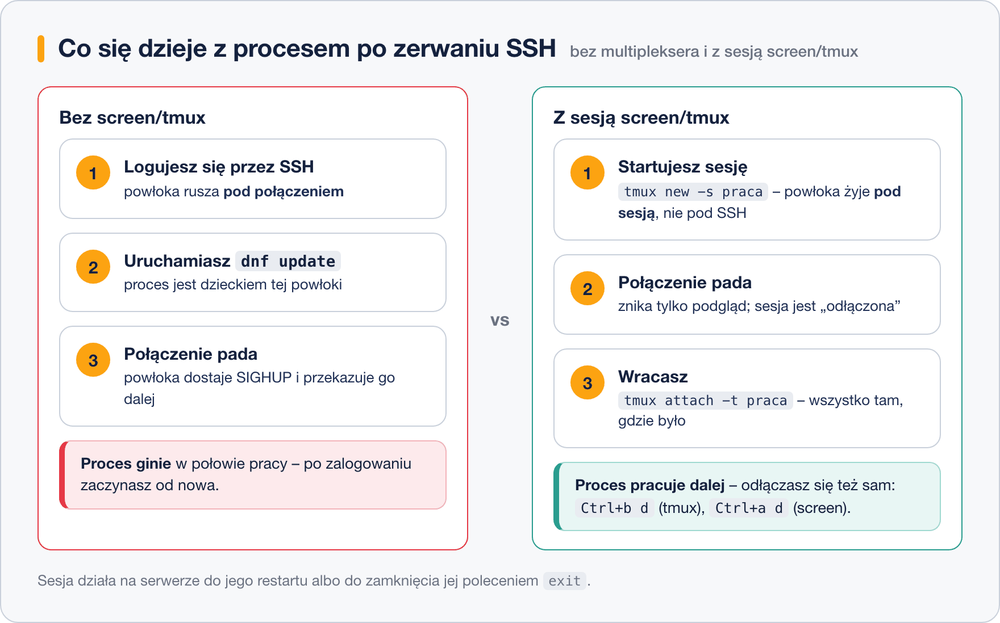

# Sesje terminala – screen i tmux

> **W tej lekcji:** nauczysz się uruchamiać na serwerze procesy, które przeżyją zerwanie połączenia
> SSH – w sesjach `screen` i `tmux` – oraz wracać do nich dokładnie tam, gdzie skończyłeś.

Łączysz się z serwerem przez SSH i uruchamiasz aktualizację systemu albo kopiowanie dużego katalogu.
W połowie pada Wi-Fi, laptop usypia się, VPN się rozłącza. Po ponownym zalogowaniu
zastaniesz przykrą prawdę: **Twój proces zginął razem z połączeniem**. Powłoka, która go uruchomiła,
dostała sygnał rozłączenia (SIGHUP, ang. hangup – „odwieszono słuchawkę”) i przekazała go dzieciom.

Multiplekser terminala (ang. terminal multiplexer) – `screen` lub `tmux` – rozcina tę zależność.
Sesja z Twoimi programami działa na serwerze **niezależnie od połączenia**. Ty się odłączasz
i podłączasz, a programy pracują dalej.

## Jak to działa

Po uruchomieniu `screen`/`tmux` na serwerze powstaje dodatkowy proces-opiekun, a Ty pracujesz
w powłoce uruchomionej **pod nim**, nie pod SSH. Gdy połączenie padnie, ginie tylko Twój „podgląd”;
sesja z programami zostaje odłączona (ang. detached) i czeka.



Oba programy robią to samo; różnią się wiekiem i wygodą:

- **screen** – klasyk, spotkasz go wszędzie, także na starych systemach. Skróty zaczynają się od `Ctrl+a`.
- **tmux** – nowocześniejszy standard: czytelny pasek stanu, wygodne dzielenie okna na panele,
  aktywnie rozwijany. Skróty zaczynają się od `Ctrl+b`. Jeśli zaczynasz od zera – ucz się tmuksa.

Na RHEL oba instalujesz z repozytoriów: `tmux` ze standardowych, `screen` z EPEL.

## W praktyce

```bash
# instalacja (screen wymaga repozytorium EPEL)
sudo dnf install tmux
sudo dnf install epel-release && sudo dnf install screen
```

### screen

```bash
# nowa sesja o nazwie aktualizacja – nazwa bardzo ułatwia powrót
screen -S aktualizacja
```

Jesteś w sesji – wygląda jak zwykły terminal. Uruchom, co trzeba, np. `sudo dnf update`.
Teraz odłącz się **bez przerywania pracy**: wciśnij `Ctrl+a`, puść, potem `d` (detach).

```text
[detached from 3412.aktualizacja]
```

```bash
# lista sesji – także po ponownym zalogowaniu przez SSH
screen -ls
```

```text
There is a screen on:
        3412.aktualizacja       (Detached)
1 Socket in /run/screen/S-admin.
```

```bash
# powrót do sesji (resume); przy jednej sesji wystarczy samo screen -r
screen -r aktualizacja
```

Wewnątrz sesji możesz mieć wiele okien: `Ctrl+a c` tworzy nowe, `Ctrl+a n` i `Ctrl+a p` przełączają
następne/poprzednie, `Ctrl+a "` pokazuje listę. Sesję kończysz definitywnie, zamykając wszystkie
powłoki (`exit`).

### tmux

```bash
# nowa nazwana sesja
tmux new -s aktualizacja
```

Na dole pojawia się zielony pasek stanu – jesteś w tmuksie. Odłączenie: `Ctrl+b`, puść, potem `d`.

```bash
# lista sesji i powrót
tmux ls
tmux attach -t aktualizacja
```

```text
aktualizacja: 1 windows (created Sat Oct 18 11:02:33 2026)
```

Okna i panele (podział jednego okna na kilka terminali obok siebie):

| Skrót | Działanie |
|---|---|
| `Ctrl+b c` | nowe okno |
| `Ctrl+b n` / `Ctrl+b p` | następne / poprzednie okno |
| `Ctrl+b %` | podział pionowy (dwa panele obok siebie) |
| `Ctrl+b "` | podział poziomy (jeden nad drugim) |
| `Ctrl+b` + strzałka | przejście między panelami |
| `Ctrl+b x` | zamknięcie panelu (z potwierdzeniem) |

Typowy układ administratora: w lewym panelu `sudo journalctl -f`, w prawym wydajesz polecenia
i od razu widzisz, co system na nie mówi.

### Ściąga screen ↔ tmux

| Czynność | screen | tmux |
|---|---|---|
| nowa nazwana sesja | `screen -S nazwa` | `tmux new -s nazwa` |
| odłączenie | `Ctrl+a d` | `Ctrl+b d` |
| lista sesji | `screen -ls` | `tmux ls` |
| powrót do sesji | `screen -r nazwa` | `tmux attach -t nazwa` |
| nowe okno | `Ctrl+a c` | `Ctrl+b c` |
| następne okno | `Ctrl+a n` | `Ctrl+b n` |
| lista okien | `Ctrl+a "` | `Ctrl+b w` |
| podział na panele | `Ctrl+a S` / `Ctrl+a \|` | `Ctrl+b "` / `Ctrl+b %` |
| zakończenie sesji | `exit` we wszystkich oknach | `exit` we wszystkich oknach |

### Najprostsza alternatywa: `nohup` i `&`

Gdy chcesz tylko „odpalić i zapomnieć” jedno polecenie, multiplekser to armata na wróbla:

```bash
# & uruchamia w tle, nohup uodparnia na rozłączenie, wyjście trafia do pliku
nohup tar czf /tmp/kopia.tar.gz /home > /tmp/kopia.log 2>&1 &
```

Proces przeżyje wylogowanie, ale **nie wrócisz do jego terminala** – zobaczysz tylko plik z logiem.
Do zadań interaktywnych (instalator zadaje pytania, chcesz podejrzeć postęp) bierz screen/tmux.
Trzecia droga, dla zadań cyklicznych, to usługi i timery systemd.

## Najczęstsze błędy i pułapki

- **`exit` zamiast odłączenia.** `exit` zamyka powłokę i kończy sesję razem z procesami.
  Odłączasz się skrótem: `Ctrl+a d` (screen) / `Ctrl+b d` (tmux).
- **Skróty mylą się między programami.** W screenie prefiksem jest `Ctrl+a`, w tmuksie `Ctrl+b`.
  Jeśli `Ctrl+a d` „nie działa”, sprawdź pasek na dole – zielony pasek oznacza tmux.
- **`There is no screen to be resumed`** – sesja nie istnieje: zginęła przy restarcie serwera
  (sesje nie przeżywają restartu!) albo uruchomiłeś ją jako inny użytkownik (np. przez `sudo screen`).
- **Sesja `(Attached)` i nie można wejść** – jesteś podłączony gdzieś indziej (np. w zawieszonym
  terminalu). `screen -dr nazwa` lub `tmux attach -d -t nazwa` odłączy tamto podłączenie.
- **Praca w sesji na koncie root „bo wygodniej”.** Uruchamiaj sesję na swoim koncie, a `sudo`
  używaj wewnątrz – widać wtedy w logach, kto co zrobił.

## Podsumowanie

- Zerwane SSH zabija procesy uruchomione w tej powłoce; sesja screen/tmux żyje na serwerze niezależnie.
- Rytm pracy: `tmux new -s nazwa` → praca → `Ctrl+b d` → (rozłączenie) → `tmux attach -t nazwa`.
- screen to klasyk (prefiks `Ctrl+a`), tmux to nowoczesny standard (prefiks `Ctrl+b`) z panelami.
- Nazywaj sesje po zadaniu – po tygodniu `aktualizacja` mówi więcej niż `3412.pts-0`.
- Do nieinteraktywnego „odpal i zapomnij” wystarczy `nohup polecenie &`.
- Żadna sesja nie przeżyje restartu serwera.
