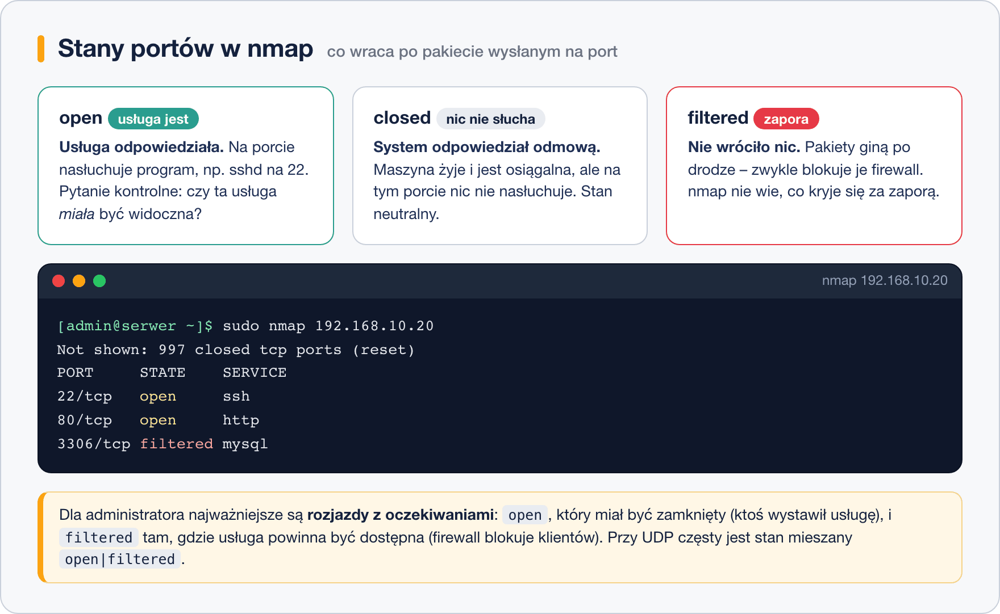

# nmap – wprowadzenie i etyka

> **W tej lekcji:** dowiesz się, do czego administrator używa skanera portów, jakie są granice
> prawne skanowania, i wykonasz pierwsze skany: własnej maszyny i własnej podsieci.

Zarządzasz serwerem (albo całą siecią) i chcesz wiedzieć, **co właściwie jest z zewnątrz widoczne**.
Czy baza danych przypadkiem nie nasłuchuje na publicznym adresie? Czy firewall naprawdę blokuje to,
co miał blokować? Jakie urządzenia w ogóle działają w sieci szkoleniowej?

`nmap` (Network Mapper) odpowiada na te pytania: wysyła do wskazanych adresów pakiety i na
podstawie odpowiedzi ustala, które maszyny żyją i jakie **porty** (punkty komunikacyjne usług,
numerowane 0–65535) są na nich otwarte. Zanim go jednak uruchomisz – jedna rzecz jest ważniejsza
od składni.

### Najpierw etyka i prawo

**Skanujesz wyłącznie systemy własne albo takie, na których skanowanie masz wyraźną zgodę
właściciela** (na piśmie, jeśli to nie Twoja firma). Skanowanie cudzych maszyn bywa traktowane jak
przygotowanie do włamania – w Polsce może podpadać pod przepisy karne o nieuprawnionym dostępie,
a dostawcy internetu blokują za nie konta. Na szkoleniu skanujesz **tylko swoją maszynę
i sieć szkoleniową**. Te same polecenia na adresach z internetu to już nie nauka, tylko incydent.

> **Dobra praktyka:** zanim przeskanujesz sieć firmową, poinformuj osoby odpowiedzialne – skan
> potrafi uruchomić alarmy systemów bezpieczeństwa i wyglądać jak atak.

## Jak to działa

nmap wysyła pakiet na konkretny port i patrzy, co wróci. Odpowiedzi układają się w trzy główne stany:



| Stan | Co wróciło | Co to znaczy |
|---|---|---|
| `open` | usługa odpowiedziała | na porcie nasłuchuje program – wejście jest |
| `closed` | system odpowiedział „nic tu nie ma” | maszyna żyje, ale na tym porcie nic nie nasłuchuje |
| `filtered` | nic (albo odmowa z firewalla) | pakiety ginie po drodze – zwykle zapora; nmap nie wie, co jest za nią |

Bywają też stany mieszane (`open|filtered`, częste przy UDP) – nmap uczciwie przyznaje,
że nie umie rozstrzygnąć.

Dla administratora najciekawsze są rozjazdy z oczekiwaniami: port `open`, który miał być zamknięty
(ktoś wystawił usługę), i `filtered` tam, gdzie usługa powinna działać (firewall blokuje klientów).

## W praktyce

```bash
# instalacja na RHEL i pochodnych
sudo dnf install nmap
nmap --version
```

> **Na Ubuntu/Debianie:** `sudo apt install nmap`.

### Pierwszy skan: własna maszyna

```bash
# skan najpopularniejszych 1000 portów TCP na własnej maszynie
nmap localhost
```

```text
Starting Nmap ( https://nmap.org )
Nmap scan report for localhost (127.0.0.1)
Host is up (0.000010s latency).
Not shown: 998 closed tcp ports (conn-refused)
PORT    STATE SERVICE
22/tcp  open  ssh
631/tcp open  ipp

Nmap done: 1 IP address (1 host up) scanned in 0.05 seconds
```

Jak to czytać:

- `Host is up` – maszyna odpowiada.
- `Not shown: 998 closed` – zdecydowana większość portów jest zamknięta (dobrze!).
- Tabela `PORT / STATE / SERVICE` – co nasłuchuje. `SERVICE` to nazwa **typowa** dla numeru portu
  (z pliku `/etc/services`), nie dowód, że naprawdę działa tam SSH.

Uwaga: skan `localhost` omija firewall. Prawdziwy obraz „z zewnątrz” zobaczysz, skanując adres
maszyny **z innej maszyny** w sieci:

```bash
# tak Twój serwer widzą inni – tu z maszyny kolegi na adres 192.168.10.20
nmap 192.168.10.20
```

### Kto żyje w sieci: odkrywanie hostów

```bash
# -sn: tylko sprawdź, które adresy odpowiadają, bez skanowania portów
nmap -sn 192.168.10.0/24
```

```text
Nmap scan report for 192.168.10.1
Host is up (0.0019s latency).
Nmap scan report for 192.168.10.20
Host is up (0.00041s latency).
Nmap done: 256 IP addresses (2 hosts up) scanned in 2.31 seconds
```

Zapis `192.168.10.0/24` oznacza całą podsieć (adresy .0–.255). To najszybszy sposób na
inwentaryzację: „jakie urządzenia są teraz w sieci szkoleniowej?”.

### Porównanie z widokiem od środka

Skaner pokazuje widok z zewnątrz; od środka to samo sprawdza `ss`:

```bash
# co naprawdę nasłuchuje na mojej maszynie (TCP i UDP)
sudo ss -tulnp
```

Jeśli `ss` pokazuje usługę, a nmap z innej maszyny jej nie widzi – między wami stoi firewall.
To częsty i bardzo pouczający eksperyment.

## Najczęstsze błędy i pułapki

- **Skanowanie adresów spoza własnej sieci** – patrz sekcja o etyce. Nawet „tylko jeden skan”
  publicznego serwera to proszenie się o kłopoty.
- **Wyciąganie wniosków ze skanu `localhost`.** Połączenia lokalne omijają firewall; zawsze
  weryfikuj też z innej maszyny.
- **Mylenie `SERVICE` z rzeczywistością.** Kolumna SERVICE to zgadywanka po numerze portu.
  Rzeczywistą usługę i wersję pokaże dopiero `-sV` (następna lekcja).
- **„Host seems down” dla maszyny, która działa.** Firewall może blokować także pakiety
  rozpoznawcze. Opcja `-Pn` każe skanować mimo braku odpowiedzi na ping.
- **Zdziwienie, że wyniki się różnią między uruchomieniami.** Usługi startują i gasną, DHCP
  zmienia adresy – skan to zdjęcie chwili, nie stała prawda.

## Podsumowanie

- nmap mapuje sieć: które maszyny żyją i jakie porty są otwarte.
- Skanujesz tylko swoje systemy albo za wyraźną zgodą właściciela – bez wyjątków.
- Trzy stany: `open` (usługa jest), `closed` (nic nie nasłuchuje), `filtered` (firewall ukrywa).
- `nmap localhost` omija firewall – prawdziwy obraz daje skan z innej maszyny.
- `nmap -sn podsieć/24` to szybka inwentaryzacja bez dotykania portów.

| Zadanie | Polecenie |
|---|---|
| instalacja | `sudo dnf install nmap` |
| skan własnej maszyny | `nmap localhost` |
| skan konkretnego hosta | `nmap 192.168.10.20` |
| kto żyje w podsieci | `nmap -sn 192.168.10.0/24` |
| widok od środka (porównanie) | `sudo ss -tulnp` |
