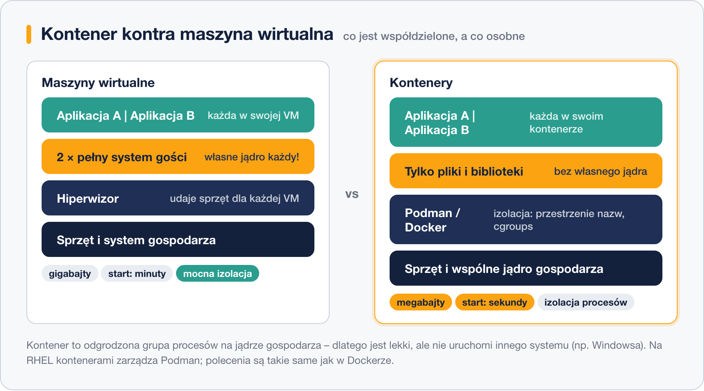

# Czym są kontenery

> **W tej lekcji:** zrozumiesz, czym kontener różni się od maszyny wirtualnej, co to jest obraz,
> rejestr i warstwa, oraz dlaczego na RHEL polecenia Dockera wykonuje Podman.

Klasyczny problem wdrożeń: aplikacja działała u programisty, a na serwerze nie, bo „inna wersja biblioteki”.
Kontener rozwiązuje ten problem brutalnie prosto – **pakuje aplikację razem ze wszystkim, czego
potrzebuje** (biblioteki, konfiguracja, pliki), w jedną przenośną paczkę. Taka paczka uruchomi się
tak samo na laptopie, serwerze szkoleniowym i w chmurze.

Dla administratora kontenery to też porządek: zamiast instalować w systemie pięć aplikacji, które
gryzą się wersjami bibliotek, uruchamiasz pięć odizolowanych kontenerów. Aktualizacja? Usuwasz
kontener i startujesz nowy z nowszego obrazu.

## Jak to działa

### Kontener kontra maszyna wirtualna

Maszyna wirtualna udaje **cały komputer**: ma własny wirtualny sprzęt, własne jądro i pełny system
operacyjny. Kontener to tylko **odgrodzona grupa procesów**, która współdzieli jądro z systemem
gospodarza – izolację zapewniają mechanizmy jądra Linux (przestrzenie nazw i cgroups), a nie
wirtualny sprzęt.



| Cecha | Kontener | Maszyna wirtualna |
|---|---|---|
| rozmiar | megabajty–setki MB | gigabajty |
| start | ułamki sekund–sekundy | minuty |
| jądro | wspólne z gospodarzem | własne |
| izolacja | na poziomie procesów | na poziomie „sprzętu” – mocniejsza |
| system w środku | tylko pliki dystrybucji, bez jądra | pełny system |
| typowe użycie | jedna aplikacja/usługa | cały serwer, inny system (Windows) |

Jedno i drugie ma swoje miejsce: kontener nie uruchomi Windowsa na Linuksie, a maszyna wirtualna
to przesada, gdy chcesz tylko odpalić serwer WWW.

### Obraz, kontener, rejestr, warstwy

- **Obraz** (ang. image) – szablon tylko do odczytu: system plików aplikacji plus metadane
  (co uruchomić, jakie porty wystawić). Jak płyta instalacyjna albo przepis.
- **Kontener** – uruchomiony egzemplarz obrazu: obraz + cienka warstwa zapisu + działający proces.
  Jak upieczone ciasto z przepisu; z jednego obrazu możesz wystartować wiele kontenerów.
- **Rejestr** (ang. registry) – serwer z gotowymi obrazami, odpowiednik repozytorium pakietów.
  Najbardziej znane: Docker Hub (docker.io) i Quay (quay.io, używany przez Red Hata).
- **Warstwy** – obraz składa się z nakładanych na siebie warstw (system bazowy → biblioteki →
  aplikacja). Warstwy wspólne dla wielu obrazów pobierają się i leżą na dysku tylko raz.

### Podman – Docker po redhatowemu

Docker spopularyzował kontenery, ale na RHEL 9/10 domyślnym narzędziem jest **Podman**.
Robi to samo, używa tych samych obrazów i **tych samych poleceń** – do tego stopnia, że możesz
ustawić `alias docker=podman` (a pakiet `podman-docker` robi to systemowo) i instrukcje pisane
„pod Dockera” zadziałają.

Najważniejsze różnice:

| | Podman (RHEL) | Docker |
|---|---|---|
| instalacja | `sudo dnf install podman` – w standardowych repozytoriach | repozytorium docker.com (pakiety `docker-ce`) |
| architektura | bez centralnego demona; kontenery to zwykłe procesy użytkownika | centralny demon `dockerd` działający jako root |
| root | domyślnie **rootless** – kontenery bez uprawnień administratora | klasycznie przez demona roota (tryb rootless też istnieje) |
| wsparcie | wspierany przez Red Hata w RHEL | pakiety spoza dystrybucji |

W tym module używamy Podmana, poleceń nie odróżnisz od dockerowych. Jeśli kiedyś trafisz na serwer
z prawdziwym Dockerem – umiesz już wszystko, łącznie z tym, że `docker` wymaga tam zwykle
członkostwa w grupie `docker` albo sudo.

## W praktyce

```bash
# instalacja Podmana (na wielu instalacjach RHEL już jest)
sudo dnf install podman
podman --version
```

```bash
# opcjonalnie: pakiet podman-docker sprawia, że polecenie docker wywołuje podmana
sudo dnf install podman-docker
docker --version
```

Pierwszy kontener – bez sudo, bo Podman działa rootless:

```bash
# pobiera malutki obraz i uruchamia w nim jedno polecenie
podman run --rm quay.io/libpod/alpine echo "Witaj z kontenera"
```

```text
Trying to pull quay.io/libpod/alpine:latest...
Getting image source signatures
Copying blob 9d16cba9fb96 done
Storing signatures
Witaj z kontenera
```

Co się właśnie stało:

1. Podman nie znalazł obrazu lokalnie, więc pobrał go z rejestru (Quay).
2. Utworzył kontener z obrazu i uruchomił w nim `echo`.
3. Proces się skończył, a `--rm` posprzątał kontener.

Obraz został na dysku – kolejne uruchomienie będzie natychmiastowe:

```bash
podman images
```

```text
REPOSITORY              TAG     IMAGE ID      CREATED      SIZE
quay.io/libpod/alpine   latest  961769676411  5 years ago  5.85 MB
```

Przy pobieraniu po samej nazwie (np. `podman pull nginx`) Podman zapyta, z którego rejestru
pobrać – dlatego w materiałach podajemy pełne nazwy, np. `docker.io/library/nginx`.

## Najczęstsze błędy i pułapki

- **Traktowanie kontenera jak maszyny wirtualnej** – logowanie „do środka” i instalowanie tam
  pakietów na stałe. Zmiany w kontenerze giną wraz z nim; trwałe zmiany robi się w obrazie
  (lekcja 3) lub na wolumenie (lekcja 2).
- **Zdziwienie, że w kontenerze „nie ma systemd, ping, vi…”.** Obrazy są celowo minimalne –
  zawierają tylko to, czego aplikacja potrzebuje.
- **Mylenie obrazu z kontenerem.** `podman images` pokazuje szablony, `podman ps -a` – egzemplarze.
  Usunięcie kontenera nie usuwa obrazu i odwrotnie.
- **Uruchamianie wszystkiego przez sudo z przyzwyczajenia.** W Podmanie sudo zwykle nie jest
  potrzebne; kontenery rootless są bezpieczniejsze. Wyjątek: porty poniżej 1024.
- **Założenie, że kontener = Docker.** Kontenery to standard (OCI); Docker i Podman to tylko
  narzędzia, które nimi zarządzają.

## Podsumowanie

- Kontener pakuje aplikację z zależnościami i współdzieli jądro gospodarza – lekki i szybki,
  ale to izolacja procesów, nie osobny komputer.
- Obraz = szablon z rejestru; kontener = uruchomiony egzemplarz; warstwy oszczędzają miejsce.
- Na RHEL używasz Podmana: te same polecenia co Docker, bez centralnego demona, domyślnie bez roota.
- Docker CE da się zainstalować z repozytorium docker.com, ale w świecie RHEL to droga okrężna.
- `podman run --rm obraz polecenie` – najprostszy kontakt z kontenerem.
