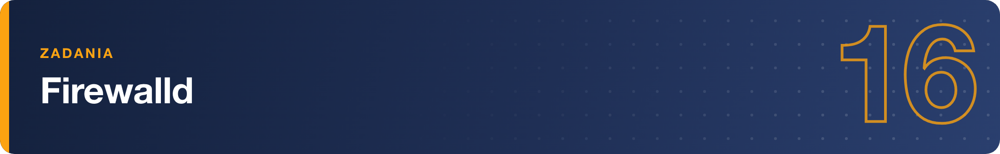

# Zadania – Firewalld

Zadania wykonuj na maszynie szkoleniowej z rodziny RHEL (Rocky/AlmaLinux). Przed zmianami upewnij się, że masz dostęp do konsoli maszyny — gdybyś przypadkiem odciął sobie SSH.

***Rozeznanie***

**1.** Sprawdź, czy usługa firewalld działa i czy wstanie po restarcie systemu. Następnie ustal, która strefa jest aktywna, do jakiej karty sieciowej jest przypisana i jakie usługi są w niej obecnie dozwolone.

___

***Otwieranie usług***

**2.** Otwórz na serwerze ruch HTTP i HTTPS tak, żeby reguły przetrwały restart. Po dodaniu reguł sprawdź listę dozwolonych usług — najpierw bez przeładowania konfiguracji, potem po przeładowaniu. Wyjaśnij, dlaczego wyniki się różnią.

___

***Porty i usługi własne***

**3.** Aplikacja firmowa nasłuchuje na porcie 8080/tcp, a firewalld nie ma dla niej gotowej usługi. Otwórz ten port na stałe i potwierdź, że znalazł się na liście portów. Następnie sprawdź, czy wśród predefiniowanych usług firewalld istnieje usługa o nazwie `mysql`.

___

***Dostęp z wybranej sieci***

**4.** Zabezpiecz SSH tak, aby można się było łączyć **wyłącznie** z sieci `192.168.10.0/24`: usuń ogólną regułę dla usługi ssh i dodaj regułę rozszerzoną (rich rule) zezwalającą na ssh tylko z tej sieci. Sprawdź efekt na liście reguł strefy.

___

***Sprzątanie i sytuacja awaryjna***

**5.** Cofnij zmiany z zadań 2–4: usuń usługi http i https, port 8080/tcp oraz regułę rozszerzoną, i przywróć zwykły dostęp do ssh. Na koniec włącz tryb paniki, sprawdź jego stan i wyłącz go.
