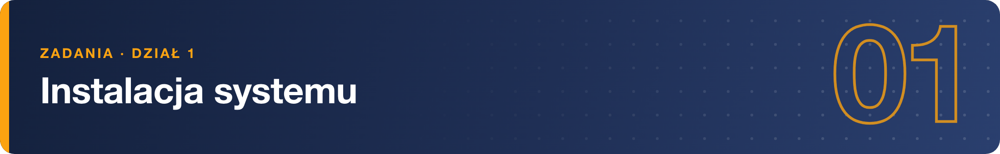

# Zadania – Instalacja systemu

> Zestawy odpowiadają kolejnym tematom modułu; numeracja zaczyna się od nowa w każdym z nich.

## Wprowadzenie do systemu Linux

**1.** Na jakich platformach sprzętowych można uruchomić Linuksa?  

**2.** Jak wybrać odpowiednią wersję systemu Linux do swoich potrzeb?  

**3.** Czym różnią się od siebie dystrybucje: RHEL, CentOS i CentOS Stream?  

**4.** Jak przebiega typowa instalacja systemu Linux?  

**5.** Czym jest SWAP i jakie są różnice między jego włączeniem a wyłączeniem?  

**6.** Jak dobrać odpowiedni rozmiar partycji SWAP do swojego systemu?  

**7.** Czym różni się środowisko graficzne (Desktop Environment) od menedżera okien (Window Manager)?  

**8.** Jakie są główne zalety korzystania z CLI (Command Line Interface) w porównaniu do GUI?  

**9.** Wymień po 3 zalety i 3 wady środowiska graficznego (GUI).

## Rodzina RHEL

**1.** Daj swojemu użytkownikowi "szkolenie" uprawnienia do używania polecenia sudo

**2.** Zaktualizuj system, użyj menagera pakietów dnf a po aktualizacji sprawdź w menagerze dnf czy jakaś aktualizacja pozostała do wykonania.

**3.** Sprawdź jaki pakiet zawiera program który pozwoli Ci sprawdzić czy musisz wykonać restart systemu po aktualizacji i zainstaluj go

**4.** Sprawdź czy musisz wykonać restart systemu

**5.** Zainstaluj pakiet mc

**6.** Sprawdź komendą man opis programu mc

**7.** Sprawdź stronę pomocy za pomocą polecenia man dla pakietu mc

**8.** Sprawdź jakie serwisy są uruchomione w systemie

**9.** Sprawdź status serwisu firewall oraz ssh

**10.** Sprawdź plik konfiguracyjny SSH i zobacz na jakim porcie działa twoja usługa SSH

**11.** Sprawdź do jakich subskrypcji masz dostęp w systemie RHEL
