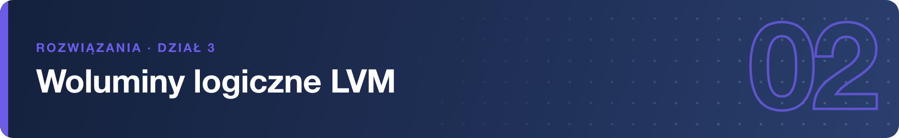

# Rozwiązania – Woluminy logiczne LVM

> **OSTRZEŻENIE:** polecenia zmieniające wykonujemy wyłącznie na dyskach ćwiczeniowych `/dev/sdb` i `/dev/sdc`. **Nigdy na `/dev/sda`** ani na systemowej grupie woluminów (`rl`/`cs`/`rhel`) – `pvcreate`, `vgremove` czy `lvremove` na nich zniszczą system. Przed każdym poleceniem sprawdź urządzenie w `lsblk`.

## 1.

```bash
lsblk -f /dev/sdb /dev/sdc
```

Dyski są czyste, gdy nie mają partycji ani wartości w kolumnie FSTYPE.

---

## 2.

```bash
sudo vgs
sudo lvs
```

Instalator tworzy grupę `rl` (Rocky; na RHEL `rhel`, na CentOS Stream `cs`) z woluminami `root` i `swap`.

---

## 3.

```bash
sudo fdisk /dev/sdb
# g,  n ⏎ ⏎ ⏎  (cały dysk),  t → lvm,  w
lsblk -o NAME,SIZE,PARTTYPENAME /dev/sdb
```

Typ „Linux LVM” to etykieta przeznaczenia partycji – formalnie nie jest wymagany przez `pvcreate`, ale utrzymuje porządek.

---

## 4.

```bash
sudo pvcreate /dev/sdb1
sudo pvs
```

PV to najniższa warstwa LVM – „cegła” oddana do dyspozycji menedżera woluminów.

---

## 5.

```bash
sudo vgcreate vg_szkolenie /dev/sdb1
sudo vgs vg_szkolenie
```

Kolumny `VSize`/`VFree` pokazują rozmiar puli i wolne miejsce (~10 GiB).

---

## 6.

```bash
sudo lvcreate -L 5G -n lv_szkolenie vg_szkolenie
sudo lvs
```

`-L` podaje rozmiar bezwzględny, `-n` nazwę woluminu.

---

## 7.

```bash
ls -l /dev/vg_szkolenie/lv_szkolenie /dev/mapper/vg_szkolenie-lv_szkolenie
```

Obie ścieżki to dowiązania do tego samego urządzenia device mappera (`/dev/dm-X`).

---

## 8.

```bash
sudo mkfs.xfs /dev/vg_szkolenie/lv_szkolenie
sudo mkdir -p /szkolenie
sudo mount /dev/vg_szkolenie/lv_szkolenie /szkolenie
echo "LVM dziala" | sudo tee /szkolenie/test.txt
```

Wolumin logiczny montuje się jak zwykłą partycję; trwałe montowanie wymagałoby wpisu w `/etc/fstab`.

---

## 9.

```bash
df -h /szkolenie
```

Widać urządzenie `/dev/mapper/vg_szkolenie-lv_szkolenie`, rozmiar ~5 GiB i użycie.

---

## 10.

```bash
sudo lvextend -r -L +2G /dev/vg_szkolenie/lv_szkolenie
df -h /szkolenie
```

Opcja `-r` rozciąga system plików razem z woluminem – `df` od razu pokazuje ~7 GiB, bez odmontowywania.

---

## 11.

```bash
sudo pvcreate /dev/sdc
sudo vgextend vg_szkolenie /dev/sdc
sudo vgs vg_szkolenie
```

`VFree` rośnie o ~10 GiB – pula może składać się z dysków i partycji jednocześnie.

---

## 12.

```bash
sudo lvextend -r -l +100%FREE /dev/vg_szkolenie/lv_szkolenie
df -h /szkolenie
```

Małe `-l` z `+100%FREE` oznacza „dodaj wszystkie wolne PE grupy”.

---

## 13.

```bash
sudo vgdisplay vg_szkolenie
sudo lvdisplay /dev/vg_szkolenie/lv_szkolenie
```

`vgdisplay` pokazuje m.in. `PE Size` (4 MiB), `Total PE`, `Alloc PE` i `Free PE`.

---

## 14.

`lvextend -r` powiększa wolumin **i od razu** rozciąga system plików. Bez `-r` rośnie tylko wolumin – system plików trzeba rozciągnąć osobno: `sudo xfs_growfs /szkolenie` dla XFS (argumentem jest punkt montowania) albo `sudo resize2fs /dev/vg_szkolenie/lv_szkolenie` dla ext4 (argumentem jest urządzenie).

---

## 15.

XFS nie ma mechanizmu zmniejszania – jego struktury danych rozkładają się po całej przestrzeni i nie da się ich bezpiecznie „zwinąć”. Jedyna droga to kopia danych, usunięcie i odtworzenie mniejszego woluminu. Wniosek praktyczny: woluminy twórz raczej mniejsze („na styk”) i powiększaj w miarę potrzeb – w drugą stronę drogi nie ma.

---

## 16.

```bash
sudo lvcreate -s -L 1G -n lv_szkolenie_przed /dev/vg_szkolenie/lv_szkolenie
echo "zmiana po migawce" | sudo tee /szkolenie/test.txt
sudo lvs
sudo lvremove /dev/vg_szkolenie/lv_szkolenie_przed
```

W `lvs` migawka ma wypełnioną kolumnę `Origin` i rosnący `Data%` – zajmuje tylko tyle, ile danych zmieniło się od jej utworzenia.

---

## 17.

RAID (mdadm) daje odporność na awarię dysku, LVM – elastyczny podział i powiększanie. Warstwy od dołu: dyski fizyczne → macierz `mdadm` (`/dev/md0`) → `pvcreate /dev/md0` → grupa woluminów → woluminy logiczne → systemy plików. Awaria jednego dysku jest wtedy niewidoczna dla LVM i danych.

---

## 18.

```bash
sudo umount /szkolenie
sudo lvremove /dev/vg_szkolenie/lv_szkolenie
sudo vgremove vg_szkolenie
sudo pvremove /dev/sdb1 /dev/sdc
lsblk
```

Kolejność musi być odwrotna do tworzenia, bo każda warstwa opiera się na niższej: nie można usunąć grupy, w której istnieją woluminy, ani PV należącego do grupy. Na koniec można też usunąć partycję `/dev/sdb1` w `fdisk` (d, w), by dysk był całkiem czysty.
