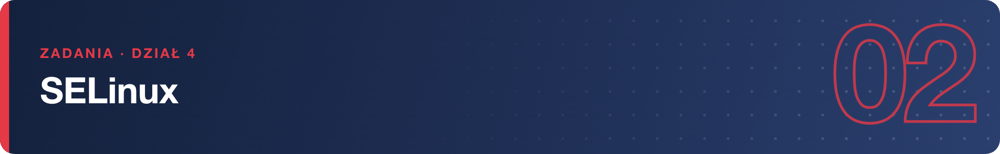

# Zadania – SELinux

**1.** Sprawdź bieżący tryb pracy SELinuksa dwoma różnymi sposobami (polecenie krótkie i rozbudowane podsumowanie). Jaka polityka jest używana?

**2.** Wyświetl kontekst SELinux: a) swojego procesu powłoki, b) katalogu `/var/www/html` (jeśli nie istnieje — zainstaluj pakiet `httpd`), c) pliku `/etc/passwd`. Wskaż w każdym z nich pole typu.

**3.** Przełącz SELinux w tryb permissive, potwierdź zmianę, a następnie wróć do enforcing. Dlaczego ta zmiana nie przetrwa restartu i gdzie ustawia się tryb na stałe?

**4.** Zainstaluj i uruchom serwer `httpd`, a następnie utwórz plik `index.html` w katalogu domowym i **przenieś** go (`mv`) do `/var/www/html/`. Sprawdź kontekst przeniesionego pliku. Dlaczego serwer WWW nie może go odczytać, mimo że uprawnienia `rwx` są poprawne?

**5.** Napraw plik z zadania 4 jednym poleceniem przywracającym etykiety zgodne z polityką. Sprawdź kontekst po naprawie i potwierdź, że `curl http://localhost/index.html` działa.

**6.** Znajdź w dzienniku audytu odmowę AVC, którą spowodowało zadanie 4. Odczytaj z niej: typ procesu, typ pliku i rodzaj operacji, której odmówiono.

**7.** Utwórz katalog `/srv/strona` z plikiem `index.html` i skonfiguruj SELinux tak, aby serwer WWW mógł trwale serwować z niego treści (reguła kontekstu + nałożenie etykiet). Jak sprawdzisz, że reguła przetrwa ponowne etykietowanie systemu?

**8.** Wyświetl wszystkie booleany polityki związane z `httpd` i włącz **na stałe** ten, który pozwala serwerowi WWW łączyć się z bazami danych przez sieć. Zweryfikuj jego stan.

**9.** Sprawdź, na których portach TCP polityka pozwala nasłuchiwać serwerowi WWW (typ `http_port_t`), a następnie dodaj do tej listy port `8090/tcp` i zweryfikuj.

**10.** Zainstaluj pakiet `setroubleshoot-server` i przeanalizuj dziennik audytu poleceniem `sealert`. Czym różni się jego raport od surowego wyjścia `ausearch`?

> **Wskazówka:** narzędzie `semanage` znajdziesz w pakiecie `policycoreutils-python-utils`.
