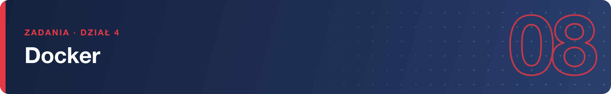

# Zadania – Docker (na Podmanie)

> Zadania wykonuj na swojej maszynie szkoleniowej jako zwykły użytkownik – Podman nie potrzebuje sudo. Wszystkie polecenia zadziałają też z aliasem `docker`, jeśli zainstalujesz `podman-docker`.

**1.** Zainstaluj Podmana (jeśli go nie ma) i sprawdź wersję. Dodatkowo zainstaluj pakiet `podman-docker` i sprawdź, co teraz robi polecenie `docker --version`.

**2.** Uruchom jednorazowy kontener z obrazu `docker.io/library/alpine`, który wypisze zawartość pliku `/etc/os-release` i sam po sobie posprząta. Jakiej dystrybucji to kontener?

**3.** Wyświetl listę lokalnych obrazów. Skąd wziął się na niej obraz alpine, skoro go nie pobierałeś poleceniem `pull`?

**4.** Uruchom w tle serwer nginx o nazwie `www` z obrazu `docker.io/library/nginx`, dostępny na porcie 8080 maszyny. Sprawdź poleceniem `curl`, że odpowiada.

**5.** Wyświetl 10 ostatnich linii logów kontenera `www`, a następnie włącz śledzenie logów na żywo i w drugim terminalu wykonaj kilka żądań `curl`. Co pojawia się w logu?

**6.** Wejdź do działającego kontenera `www` i sprawdź od środka, jaki proces ma PID 1. Wyjdź tak, żeby kontener dalej działał.

**7.** Przygotuj katalog `~/strona` z własnym plikiem `index.html` i uruchom drugi kontener nginx (`www2`, port 8081), który serwuje tę stronę z wolumenu. Pamiętaj o SELinuksie. Zmień treść pliku na gospodarzu i sprawdź, że strona zmieniła się bez restartu kontenera.

**8.** Uruchom bazę PostgreSQL 16 (`docker.io/library/postgres:16`) z hasłem przez zmienną środowiskową i danymi na wolumenie `~/pgdata`. Utwórz w niej tabelę z jednym wierszem.

**9.** Udowodnij trwałość danych: usuń kontener bazy, uruchom nowy na tym samym wolumenie i odczytaj wiersz z tabeli.

**10.** Zatrzymaj kontener `www`, obejrzyj jego stan na liście wszystkich kontenerów, uruchom go ponownie, a na końcu usuń. Czy obraz nginx nadal jest na dysku?

**11.** Zbuduj własny obraz `moj-tekst` z pliku Containerfile: baza `docker.io/library/alpine`, a domyślne polecenie wypisuje tekst `Obraz zbudowany na szkoleniu`. Uruchom go.

**12.** Sprawdź, ile miejsca zajmują obrazy i kontenery, po czym posprzątaj: usuń wszystkie zatrzymane kontenery i nieużywane obrazy.

> **Wskazówka:** gdy kontener „znika” zaraz po `run`, obejrzyj `podman ps -a` i `podman logs nazwa` –

> najczęściej aplikacji zabrakło wymaganej zmiennej `-e`.
