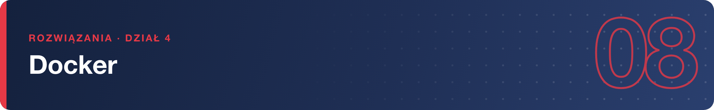

# Rozwiązania – Docker (na Podmanie)

**1.** Instalacja:
```bash
sudo dnf install podman podman-docker
podman --version
docker --version
``` `podman-docker` podstawia polecenie `docker` pod Podmana – `docker --version` wypisze wersję Podmana (i jednorazową informację o emulacji).

---

**2.** Jednorazowy kontener:
```bash
podman run --rm docker.io/library/alpine cat /etc/os-release
``` To Alpine Linux – minimalna dystrybucja, popularna baza obrazów. `--rm` usuwa kontener po zakończeniu.

---

**3.** Lista obrazów:
```bash
podman images
``` `run` sam pobiera obraz, gdy nie ma go lokalnie – `pull` wykonuje się niejawnie przy pierwszym uruchomieniu.

---

**4.** nginx w tle:
```bash
podman run -d --name www -p 8080:80 docker.io/library/nginx
curl http://localhost:8080
``` Odpowiedzią jest domyślna strona „Welcome to nginx!”.

---

**5.** Logi:
```bash
podman logs --tail 10 www
podman logs -f www        # w drugim terminalu: curl http://localhost:8080
``` Każde żądanie dopisuje linię dziennika dostępu (adres, metoda `GET /`, kod 200).

---

**6.** Wnętrze kontenera:
```bash
podman exec -it www bash
ls -l /proc/1/exe         # albo: cat /proc/1/cmdline
exit
``` PID 1 to `nginx: master process` – główny proces kontenera. `exit` zamyka tylko powłokę z `exec`, kontener działa dalej (sprawdź `podman ps`).

---

**7.** Własna strona z wolumenu:
```bash
mkdir -p ~/strona && echo "<h1>Moja strona</h1>" > ~/strona/index.html
podman run -d --name www2 -p 8081:80 -v ~/strona:/usr/share/nginx/html:Z docker.io/library/nginx
curl http://localhost:8081
echo "<h1>Po zmianie</h1>" > ~/strona/index.html
curl http://localhost:8081
``` `:Z` ustawia kontekst SELinux – bez niego nginx dostanie „Permission denied”. Wolumen to ten sam katalog, więc zmiany widać od razu.

---

**8.** PostgreSQL:
```bash
mkdir -p ~/pgdata
podman run -d --name baza -e POSTGRES_PASSWORD=tajnehaslo \
  -v ~/pgdata:/var/lib/postgresql/data:Z docker.io/library/postgres:16
podman exec -it baza psql -U postgres -c "CREATE TABLE goscie(imie text); INSERT INTO goscie VALUES ('anna');"
```

---

**9.** Trwałość danych:
```bash
podman rm -f baza
podman run -d --name baza2 -e POSTGRES_PASSWORD=tajnehaslo \
  -v ~/pgdata:/var/lib/postgresql/data:Z docker.io/library/postgres:16
podman exec -it baza2 psql -U postgres -c "SELECT * FROM goscie;"
``` Wiersz `anna` jest na miejscu – dane mieszkają na wolumenie gospodarza, nie w kontenerze.

---

**10.** Stany kontenera:
```bash
podman stop www
podman ps -a              # STATUS: Exited (0) ...
podman start www
podman rm -f www
podman images             # obraz nginx nadal jest
``` `rm` usuwa tylko kontener; obraz zostaje do kolejnych uruchomień (usuwałby go `rmi`).

---

**11.** Własny obraz:
```bash
mkdir -p ~/moj-tekst && cd ~/moj-tekst
cat > Containerfile <<'EOF'
FROM docker.io/library/alpine
CMD ["echo", "Obraz zbudowany na szkoleniu"]
EOF
podman build -t moj-tekst .
podman run --rm moj-tekst
```

---

**12.** Sprzątanie:
```bash
podman system df
podman container prune
podman image prune
``` `container prune` usuwa zatrzymane kontenery, `image prune` – obrazy bez kontenerów; pełne porządki robi `podman system prune -a`.
